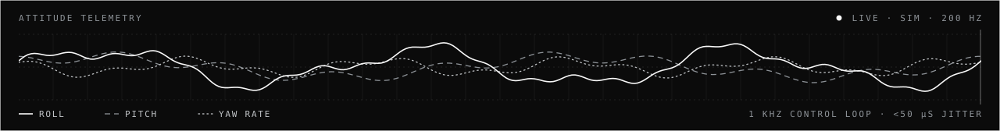

Flight-critical electronics, end to end: the power stage and the mixed-signal board, the firmware that closes a 1 kHz loop on it, the Bayesian logic that decides which sensors the aircraft should believe, and the fixtures that take the design to 100 built units at 97% first-pass acceptance. Technical Lead at [SWORT Aerospace](https://www.swort.net), while studying electrical engineering at Montgomery College.

### Measured

| | |
|---|---|
| **Flight controllers** SWORT&nbsp;Aerospace | 3 products released, 100 units built, **97% first-pass acceptance**. Control loops at **1 kHz with under 50 µs maximum observed scheduling jitter** under stress, and **1,000 cumulative hardware-in-the-loop hours without one unexpected reset**. |
| **Production** SWORT&nbsp;Aerospace | Bring-up time cut **40%** with automated fixtures and interface diagnostics. Unit cost down **22%** against the previous revision at equal batch size. **100% requirements-to-test traceability**, 45 defects closed before release. 8 paid programs led with a 5-person team. |
| **Autonomous aircraft** SWORT&nbsp;Aerospace | Flight controls, power and sensor assurance integrated into a composite airframe: **60 sorties, 30 flight hours, 50 autonomous docking cycles, 96% docked on the first attempt** inside the operating envelope. |
| **Power electronics** | Paired 4-in-1 ESCs, eight channels of bidirectional DShot600 with per-motor telemetry: **97% conversion efficiency** at nominal load, peak MOSFET temperature **15 °C lower** than the previous revision. A hybrid active/passive EMI filter: **15 dB more common-mode attenuation from 150 kHz to 1 MHz at 20% less mass**. |
| **Lander GNC** Purdue&nbsp;Space&nbsp;Program | Flight firmware against a 6-DOF simulation carrying sensor noise, thrust uncertainty and actuator limits: **990 of 1,000 Monte Carlo runs inside the landing envelope**. Attitude-tracking RMS error down **35%**, 120 automated HIL cases, safe-state transitions **inside 100 ms** for injected faults. |
| **Eco-marathon car** Shell&nbsp;Eco-marathon | 16-channel, 100 Hz STM32 telemetry with **99.9% valid-record capture over 50 test hours**. Hydraulic brakes with **12% shorter stopping distance at 18% less mass**. **10% less energy per kilometer** from control tuning on a repeatable drive cycle. |

### Open source

| | |
|---|---|
| **[csia-trust-layer](https://github.com/SWORT-Aerospace/csia-trust-layer)** | Runtime sensor assurance for autonomous aircraft. Sensors are nodes in a trust graph (8 nodes, 11 physical-relationship edges), each carrying a recursive Bayesian trust belief with adaptive forgetting; faults come out as a probability over causes, such as *89% GPS fault, 11% nominal*. The Python runtime takes about 140 µs a tick, 0.35% of its 40 ms budget, and the zero-allocation C core is parity-pinned to it at 1e-12. |
| **[sem-motor-controller](https://github.com/SWORT-Aerospace/sem-motor-controller)** | Motor control for a battery-electric Shell Eco-marathon vehicle. Every torque request passes the control contract (hardware shutdown, inhibits, hard ceilings, supervisory envelopes, comfort slew); an offline dynamic-programming optimizer plans the energy strategy; CAN codecs are generated for C and Python and checked against golden vectors. Portable C11 core, verified in host co-simulation. |
| **[RollingResistance-Simulations](https://github.com/andrefp-co/RollingResistance-Simulations)** | Rolling resistance of the Eco-marathon car, recovered from coast-down accelerometer and position logs in MATLAB, hub-only runs against motor-installed runs. |
| **[tosx](https://github.com/andrefp-co/tosx)** | A terminal-style operating system in the browser: boot log, login and a working shell, in plain HTML, CSS and JavaScript. |

### Stack

STM32H7 · ESP32 · CAN · SPI · I²C · UART · DShot600 · MAVLink · PX4 · Altium · KiCad · LTspice · SolidWorks · HIL · fault injection · Monte Carlo · 6-DOF simulation

### Elsewhere

[andres.swort.net](https://andres.swort.net) · [LinkedIn](https://www.linkedin.com/in/andrespenaavila) · [DEV](https://dev.to/andrfp) · andrfp@swort.net

<picture>
  <source media="(prefers-color-scheme: dark)" srcset="https://raw.githubusercontent.com/andrefp-co/andrefp-co/output/snake-dark.svg">
  
</picture>
